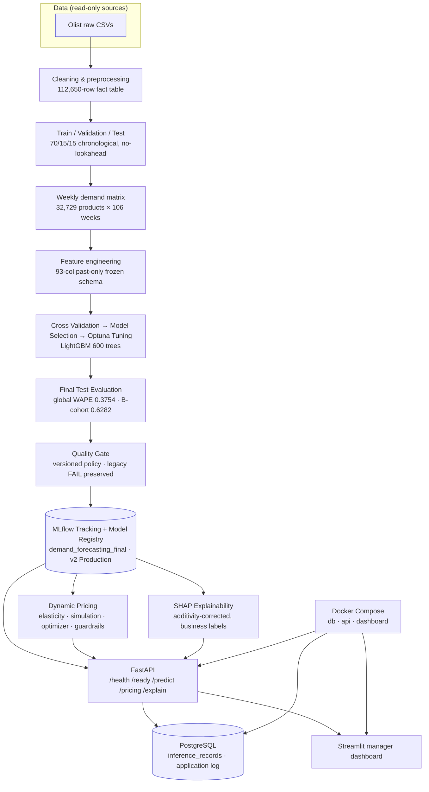

# E-Commerce Demand Forecasting & Dynamic Pricing Decision-Support System

End-to-end **demand forecasting, price-recommendation, and deployable decision support**
built on the Olist Brazilian e-commerce dataset (2016–2018). The project includes a
strictly-managed MLflow model lifecycle with an honest quality-gate story, dynamic
pricing simulation, SHAP explainability, and a FastAPI + Streamlit + PostgreSQL + Docker
deployment. All metrics below are documented values; nothing is invented.

---

## Overview

The system answers two practical questions for thousands of products:

1. **How much demand next week→** — a validated weekly forecast (LightGBM, 93 features).
2. **At what price→** — a descriptive price-response (elasticity) simulation with business
   guardrails.

It is **decision-support, not autopilot**: forecasts and price recommendations are
explained (SHAP), audit-logged (PostgreSQL), editable via guardrails, and served over a
business-level contract — callers supply a product ID (+ ISO week, and optionally a cost),
**not** the 93-feature model schema, which is built server-side.

## Business Problem

- Weekly demand across a long-tail catalogue is zero-inflated, right-skewed, and
  intermittent — naive heuristics fail (persistence baseline WAPE 1.49 vs model 0.40).
- Price recommendation needs price→demand response and a profit objective; the dataset
  has **no cost data**, so profit is honestly reported as not computable rather than
  fabricated.
- Managers need to trust and audit the numbers.

## Solution

A 6-part pipeline — data → Train/Validation/Test split → weekly demand matrix →
93-feature past-only schema → expanding-window cross validation → model selection →
Optuna tuning → final test evaluation → versioned quality gate → Production registry →
dynamic pricing layer → SHAP explainability → FastAPI/Streamlit/PostgreSQL/Docker
deployment. See [End-to-End Workflow](#end-to-end-workflow) for the full order.

## Key Capabilities

- **Forecast** weekly demand (log1p target, `expm1` inference, prediction-integrity guards).
- **Manage the lifecycle** with a versioned quality gate, a frozen protected-test split,
  and guarded promotion (no manual promotion without a persisted decision record).
- **Price** with log-log elasticity, scenario simulation, closed-form + grid optimizer,
  and configurable guardrails (margin floor · increase cap · absolute floor/ceiling ·
  exponential smoothing).
- **Explain** every prediction with SHAP on the exact production artifact (exact
  additivity-corrected reconstruction).
- **Serve** over a business-level REST API with readiness gating and PostgreSQL inference
  logging, plus a Streamlit manager dashboard and Docker Compose.

## Architecture



**Two stores, deliberately separated** — MLflow owns the model lifecycle, PostgreSQL owns
application logs. Neither substitutes for the other:

| Store | Owns | Lives |
|---|---|---|
| **MLflow Tracking + Model Registry** | experiment tracking, model packaging (PyFunc artifacts), registered versions & stages, lifecycle state | `artifacts/mlflow_tracking.db`, `mlruns/` (served **read-only**) |
| **PostgreSQL** | *application* inference log (who asked, what, when, model metadata) | compose `db` service, `pgdata` volume |

PostgreSQL is **not** the model registry: promoting a version to Production is an MLflow
registry operation recorded in `mlruns/`, not a row written to `inference_records`.

The **93-feature model schema** is internal. The **business API surface** is
`product_id` + ISO week + optional cost — the service generates the 93 features
server-side (`frozen_features_for_week`, train-only encoding, `unknown` fallback).

## End-to-End Workflow

```
Data (Olist raw CSVs, read-only)
  → merge/clean → fact table (112,650 × 23)
  → Train / Validation / Test chronological split (train 2.43M / val 0.52M / test 0.52M)
  → weekly demand matrix (3,469,274 rows = 32,729 products × 106 weeks)
  → past-only feature engineering (93-col frozen schema)
  → Cross Validation (expanding-window, no-lookahead)
  → Model Selection (LightGBM 0.4349 vs XGBoost vs naive persistence 1.4923)
  → Optuna Tuning → LightGBM winner (refit validation WAPE 0.4001 → frozen 0.3964)
  → Final Test Evaluation (global WAPE 0.3754; B-cohort 0.6282)
  → Quality Gate (versioned policy → FAIL under legacy, PASS under revised)
  → Production (MLflow registry v2, guarded promotion)
  → Dynamic Pricing (elasticity → simulation → optimizer → guardrails)
  → SHAP Explainability (on the exact Production estimator)
  → FastAPI / Streamlit
  → PostgreSQL (inference & application logging)
  → Docker (Compose: db · api · dashboard)
```

The lifecycle order is enforced, not decorative: validation/CV drive selection and tuning,
the Test split is scored once for the Final Test Evaluation, and only a passing gate
promotes a version to Production.

## Parts 1–6

| Part | Scope | Status |
|---|---|---|
| **1** | Data cleaning & preprocessing (merge, types, duplicates, missingness) | Complete |
| **2** | EDA, time-series preparation, target engineering, 70/15/15 split, features | Complete |
| **3** | Model selection, Optuna tuning, MLflow lifecycle, quality gate | Complete (no V3; history preserved) |
| **4** | Dynamic pricing: elasticity, simulation, optimizer, guardrails | Complete (profit path cost-gated) |
| **5** | SHAP explainability of the Production model | Complete |
| **6** | FastAPI, PostgreSQL, Streamlit & Docker deployment | Complete |

Per-part evidence, WHYs and decisions: `reports/forecasting/`.

## Model & Evaluation

**Production model** — `demand_forecasting_final` **v2**, stage **Production**, status
**READY**, run `5d729a8594dc488bbd18ba0c4e216f5a`, source
`models:/m-e93cadaf963a4aa1b44b3e501379da92`. LightGBM `LGBMRegressor`, 93 inputs,
600 trees, num_leaves 223, learning rate 0.008468, log1p target.

**Validation** (never on Test): WAPE **0.3964** · MAE 0.02329 · RMSE 0.25917 · MASE 0.6122
· B-cohort WAPE 0.5101 · B-cohort bias −18.2% · C-cohort WAPE 0.3795. Model beat the
persistence baseline by **~73%** on WAPE (1.4923 → 0.4001).

**Final Test evaluation**: global Test WAPE 0.3754, B-cohort WAPE **0.6282 → FAIL** under the
legacy gate, prediction integrity PASS. Under the revised policy `B_wape` is diagnostic and
v2 was promoted to **Production** (see Quality Gate).

## Quality Gate

- Two frozen, versioned policies: `quality_gate_policy_v1_legacy` (default, 19 outcomes)
  and `quality_gate_policy_v2_revised` (18 blocking + diagnostics).
- Any failed **blocking** criterion → FAIL → Staging. PASS → Production **only** through a
  persisted decision record (guarded promotion contract).
- The legacy V2 FAIL (B WAPE 0.6282 > 0.60) is **preserved verbatim**. Under the revised
  policy `B_wape` is **diagnostic** and `B_bias_pct ≥ −20` stays **hard**; the production
  decision is `REVISED_GATE_APPLIED` with the identical run.
- Two controlled validation experiments (spike features; asymmetric 2:1 quantile
  objective) both returned `NO_VALID_IMPROVEMENT` on pre-registered tolerances → **no V3,
  no retrain, no test-split access**.

## Dynamic Pricing

- **Elasticity: descriptive, not causal.** Log-log with product and product+week fixed
  effects; the artifact itself records `causal_claim: false`. Pooled product-FE
  **b = −0.3952 (SE 0.0363, t = −10.878, n = 41,452)**; validation sign+magnitude match.
  Statuses: Reliable 119 / Weak 1,589 / Insufficient 1,130 / Unsupported 16,261. A low
  pooled R² (0.0053) and mostly flat prices mean most products have no identifiable own
  price response, so these are associations — use them for scenario ranking, not for
  forecasting the effect of a real price change.
- Simulation: PED scenario grids over the reference week (2018-05-14) with extrapolation
  guards; optimizer `analytic_optimal_price` + grid.
- **Guardrails** (`src/optimization/guardrails.py`) are the real taxonomy:
  `min_margin_pct`, `max_increase_pct` (a fractional cap on the increase —
  `current * (1 + max_increase_pct)`, default 0.20), `price_floor_abs`,
  `price_ceiling_abs` and `smoothing_alpha`. Each rule records an applied-flag on the
  output row; with the default configuration the absolute bounds and smoothing are
  inactive, and the margin floor binds only when a cost is supplied.
- **Profit is cost-gated.** The objective is
  `Profit(P) = (P − Cost) × PredictedDemand(P)`, which is only computable with a cost.
  The dataset ships none, so no cost is invented: each recommendation carries an explicit
  reason instead — `PROFIT_NOT_COMPUTABLE (no cost supplied)` (468 products) or
  `NO_ELASTICITY` (917). Result for the reference week: **0 products optimized**, 16
  ceiling applications, 468 extrapolation warnings. Supplying a legitimate cost source is
  what activates the profit path; until then the system reports the gap rather than
  fabricating a number.

## Pricing Readiness Tiers

The dashboard reads the persisted Part-4 artifact
(`reports/forecasting/part4_pricing_engine.json`) and the weekly demand matrix from disk
and splits the catalogue into three tiers for a selected week, so a manager can see how
much of the catalogue is actually actionable rather than only the products that happen
to be ready.

| Tier | Condition | Reference week 2018-05-14 |
|---|---|---|
| **Tier 1 — priced & ready** | usable elasticity **and** a valid current price that week | 468 |
| **Tier 2 — ready, unpriced** | usable elasticity, no valid current price that week | 16,544 |
| **Tier 3 — not ready** | no usable own-price or category-pooled elasticity | 15,717 |

A product is only "usable-elasticity" if the persisted source is `own` or
`category_pooled`; a current price is valid only when the demand matrix has a row for
that exact ISO week with `avg_price > 0` — the same rule the API applies.

The artifact's availability is tracked explicitly as `available` / `missing` /
`unreadable`. When it is not `available`, the UI reports
`READINESS_UNAVAILABLE` rather than claiming zero ready products, so a packaging fault
can never be mistaken for a business result.

## SHAP Explainability

On the exact Production estimator (no surrogate): deterministic background 400 /
explained 1,500 reference-week rows, per-row additivity correction for LightGBM
bin-quantization drift, exact reconstruction `expm1(base + Σφ)` (residual < 1e-6 in
tests), business-labelled features. Global top: `cat_unknown` (mean |SHAP| 0.0304); price
features minor and attribution-only.

## API

FastAPI, single worker. Endpoints (OpenAPI exactly these 5 paths):

| Endpoint | Purpose |
|---|---|
| `GET  /health` | liveness (process up) |
| `GET  /ready`  | readiness gate (model + feature state + elasticity + SHAP warm-up must be ready) |
| `POST /predict` | weekly demand forecast for `product_id` (+ ISO week) |
| `POST /pricing` | elasticity + scenario simulation + guardrail-bounded recommendation (+ optional cost) |
| `POST /explain` | SHAP attribution with business labels |

Example:

```bash
curl -X POST http://localhost:8000/predict \
  -H "Content-Type: application/json" \
  -d '{"product_id":"00210e41887c2a8ef9f791ebc780cc36","week":"2018-05-14"}'
```

Structured errors (`detail`, `code`, `request_id`): `PRODUCT_NOT_FOUND`, `INVALID_WEEK`,
`WEEK_OUT_OF_SUPPORTED_RANGE`, `TEST_BOUNDARY_VIOLATION`, `MODEL_NOT_READY`,
`MODEL_LOAD_FAILED`, `INVALID_COST`, `NO_PRICE_OBSERVATION`, `NO_ELASTICITY`,
`PROFIT_NOT_COMPUTABLE`, `FEATURE_BUILD_FAILED`, `ELASTICITY_UNAVAILABLE`,
`DATABASE_UNAVAILABLE`, `PAYLOAD_TOO_LARGE`, `RATE_LIMITED`, `VALIDATION_ERROR`,
`INTERNAL_ERROR` — 422 for domain/schema, 503 for infrastructure, no stack traces.
The full catalogue lives in `app/errors.py`.

## Streamlit Dashboard

`dashboard/app.py` — manager panels for forecast, pricing, explainability, and system
status, with a searchable product selector, a week selector, and the pricing-readiness
tiering above. Panels and SHAP features are labelled with business names, never the
93-feature schema.

The dashboard is **not** a pure API client. It calls the API for forecasts, pricing and
explanations, **and** it reads two files directly from the image/container filesystem:

| Direct read | Used for |
|---|---|
| `data/processed/demand_matrix_weekly.csv.gz` | product catalogue, search/ordering, ISO-week labels, current-price presence |
| `reports/forecasting/part4_pricing_engine.json` | pricing-readiness tier counts and per-product readiness state |

Both are packaged read-only into the image (see [Image boundary](#image-boundary)). Those
direct reads serve browsing, ordering, labels and the readiness summary only — the API
remains the authority on whether a price observation is usable, and no estimation logic is
duplicated. Both files must be present on the dashboard host; the readiness state degrades
explicitly to `READINESS_UNAVAILABLE` if the pricing artifact is missing or unreadable,
rather than reporting a misleading zero. The package is intentionally named `dashboard/`
so it never shadows the installed `streamlit` framework.

## PostgreSQL

`inference_records` (SQLAlchemy) logs every success and error with request/response JSON
+ model metadata. It is an **audit/application** store; it is not a gating dependency —
if the DB is unreachable, the API still serves with `inference_logged=false`.

## MLflow

`artifacts/mlflow_tracking.db` + `mlruns/` hold the full experiment history and the
registered model (`demand_forecasting_final` v1 Staging / v2 Production). MLflow is
responsible for **experiment tracking, model packaging, the model registry, and lifecycle
state** — the served version, its stage and its decision tags. The API loads the version
artifact **read-only** (with a path-normalized fallback so Windows-baked `MLmodel` yamls
load in POSIX containers — covered by a parity test). PostgreSQL is not involved in this
path; it only receives inference/application log rows.

## Docker

- One image: `python:3.11-slim` + `libgomp1`, `PYTHONPATH=/app`, non-root uid 10001,
  used by both `api` (8000) and `dashboard` (8501).
- Compose also runs `postgres:16-alpine`. Only `api` and `dashboard` publish host ports
  (8000, 8501); the database listens on 5432 **inside the Compose network only** and is
  reachable from the host only via `docker compose exec db psql`.
- Healthchecks: `pg_isready` on `db`, `GET /ready` on `api`, `GET /_stcore/health` on
  `dashboard`. `api` waits for `db` to be healthy; `start_period: 600s` covers the
  heavy model warm-up.

### Networking

The Compose file declares **no custom networks**, so all three services join the implicit
default network that Compose creates for the project, and reach each other by service
name (`db`, `api`, `dashboard`). No external/host network exposure is required, and
`db` is not reachable from outside the project.

### Volumes

PostgreSQL data is persisted in the named volume **`pgdata`**
(`/var/lib/postgresql/data`). Consequences worth knowing:

- `docker compose down` **keeps** the volume — the inference log survives a stop/start.
- `docker compose down -v` **deletes** it, along with all logged inference records.
- The volume name is derived from the Compose project name, so it is normally
  `deployment_pgdata` when run from `deployment/`. Running Compose under a different
  project name (e.g. `-p something`) yields a *different* volume and a fresh database.

### Image boundary

`.dockerignore` excludes `data/raw`, `data/splits` (including `test.csv`), `tests`,
notebooks, root `mlflow.db`, `.env`, `.venv`, and `mlruns/.trash`. Reports are excluded
by `reports/**` with exactly one deliberate re-inclusion,
`!reports/forecasting/part4_pricing_engine.json` — the persisted pricing artifact the
dashboard reads at runtime. Every other report is excluded. The boundary was verified by
inspecting the built image: no `data/splits`, no `test.csv`, exactly one report.

## Project Structure

```
data/raw            read-only source CSVs (~126 MB; excluded from the image)
data/processed/     aggregated demand matrix (demand_matrix_weekly.csv.gz copied into the image)
data/splits/        chronological train/val/test (excluded from the image and from version control)
src/                data · features · models · explainability · optimization · utils
src/notebooks/      research notebooks + helper scripts (never a runtime surface)
app/                FastAPI service (api · services · db · middleware)
dashboard/          Streamlit manager UI (app · product_catalog · pricing_presenter · api_client · config)
deployment/         Dockerfile · docker-compose.yml · healthcheck.py
tests/              pipeline suite (275 tests) + deployment/ + dashboard/
tests/deployment/   production-deployment contract (47 fast + 8 gated integration)
tests/dashboard/    dashboard catalog / presenter / selector UI tests (72)
scripts/            dev-only utilities (verify_imports.py)
reports/            forecasting (34) · finalization (12) · deployment (3) · experiments (4) + README.md evidence index
artifacts/          trained models · MLflow artifacts · SHAP outputs · tracking DB (excluded from version control)
docs/Photos/        architecture and workflow screenshots
docs/private/       private study / interview material (excluded by .gitignore)
mlruns/             MLflow run/artifact store (excluded by .gitignore)
mlflow.db           MLflow tracking DB (also mirrored at artifacts/mlflow_tracking.db; excluded from version control)
.env.example        documented settings template (copy to .env)
.dockerignore       build-context boundary for the image
.gitignore          version-control exclusions
requirements.txt    runtime pins   ·   requirements-dev.txt  dev/test layer
```

## Installation

Requirements: **Python 3.11**, Docker Desktop (for the containerized stack).

```bash
# from an existing checkout (this tree is not yet a Git working tree)
cd E-Commerce
python -m venv .venv
.venv\Scripts\activate            # Windows (POSIX: source .venv/bin/activate)
python -m pip install -r requirements-dev.txt
```

`requirements-dev.txt` includes `requirements.txt`, so it is self-sufficient.

## Environment Setup

Copy `.env.example` → `.env` and adjust as needed. All values must match the recommended
defaults unless you know otherwise (model registry, reference week 2018-05-14, DB URL,
CORS). For a local run without Docker, comment out the compose `DATABASE_URL` in
`.env` and use the SQLite URL that is already provided commented-out in `.env.example` —
otherwise the app will try to reach a `db` host that only exists inside Compose.

To point the dashboard at an API somewhere other than `http://localhost:8000`, set
`STREAMLIT_API_BASE_URL`.

## Running Locally

```bash
python -m uvicorn app.main:app --host 0.0.0.0 --port 8000   # API
streamlit run dashboard/app.py                               # dashboard (base URL http://localhost:8000)
```

Heavy warm-up (demand matrix, frozen features, elasticity, SHAP) takes minutes on first
load; `/ready` becomes 200 when complete.

## Running with Docker Compose

```bash
cd deployment
docker compose up --build -d
# API      → http://localhost:8000  (docs at /docs)
# Dashboard→ http://localhost:8501
docker compose ps        # db, api, dashboard should all be (healthy)

cd ..                     # the next commands assume the repository root
```

`/ready` gates api health with `start_period: 600s` to cover warm-up. `db` publishes no
host port; the inference log lives in the `pgdata` named volume (see
[Volumes](#volumes)). `docker compose down` stops the stack and keeps the database;
`docker compose down -v` also removes it.

## Testing

```bash
.venv\Scripts\python -m pytest tests -q                          # full suite (402 collected)
.venv\Scripts\python -m pytest tests/deployment -q               # deployment contract (47 + 8 gated)
.venv\Scripts\python -m pytest tests/dashboard -q                # dashboard catalog/presenter/UI (72)
$env:RUN_DEPLOYMENT_INTEGRATION=1
.venv\Scripts\python -m pytest tests/deployment/test_deployment_integration.py   # real-model integration
```

The suite collects **402 tests**: 275 pipeline, 55 deployment (47 fast + 8
integration-gated), 72 dashboard. Last full run: **393 passed, 0 failed, 9 skipped** in
~10.6 minutes. The 8 integration tests are skipped unless
`RUN_DEPLOYMENT_INTEGRATION=1` is set; the 9th is
`test_gate_policy_revision.py::test_marker_records_policy_and_version`, which skips when
the local gate-revision marker file is absent.

## Limitations

- **B-cohort accuracy**: the 37-product sustained-demand cohort underforecasts burst
  weeks (validation B WAPE 0.5101, bias −18.2%); the legacy B WAPE bound failed on the
  final Test evaluation and is now a documented diagnostic.
- **No cost source** → profit optimization is delivered but correctly inert until a
  legitimate cost source is supplied.
- **Elasticity is descriptive, not causal**; most products have no identifiable own-price
  response (prices mostly flat over time).
- **Frozen snapshot (ends 2018-09-09)**: the dataset ends here, so no future validation
  period can be built without reusing development data. The Test split is pinned by
  content hash and covered by integrity guards.
- **No CI/CD or scheduler**: lifecycle gate/promotion routing is automated; the triggering
  of scoring modules is manual.
- **SHAP is attribution, not causality**; price features are minor contributors.
- **The dashboard needs its data on disk**: the weekly demand matrix and
  `reports/forecasting/part4_pricing_engine.json` must both be present, independent of
  the API. A missing pricing artifact is reported explicitly, not silently as zero.
- **Version control is not initialized** in this tree — the GitHub repository has not been
  created yet. `.gitignore` is already in place and protects the sensitive and large paths:
  `data/raw/`, `data/processed/`, `data/splits/` (including the protected `test.csv`),
  `artifacts/`, `mlruns/`, root `mlflow.db`, `docs/private/`, `.env` and the usual Python
  caches. Those exclusions take effect on the first commit, so `git add .` will not publish
  the protected split or the model stores. The project-specific technical documentation
  (`README.md`, `PROJECT_MAP.md`, `reports/`, `docs/Photos/`) stays tracked.
- `PROJECT_MAP.md` (plus `reports/` and this file) is the authoritative
  status/facts reference; there is no separate blueprint document.

## Future Work

- Supply a real **cost source** to activate the profit path.
- **Data refresh / retraining cadence** on new windows (properly gated V3 process).
- **Experiment-driven price tests** (A/B or instruments) to move elasticity toward causal.
- **Promotions data** to enrich features and reduce the `unknown`-category attribution
  share.
- **CI/CD** automation of lifecycle triggers.

## Documentation

### Public technical documentation

| Doc | What it's for |
|---|---|
| `README.md` | This file: architecture, capabilities, install/run/test, limitations |
| `PROJECT_MAP.md` | Detailed architecture and responsibility map, test-suite inventory, artifacts, known issues |
| `reports/finalization/finalization_report.md` | Finalization audit (repo, environment, reproducibility, verification) |
| `reports/README.md` | **Start here** — classifies every report as either evidence for a current workflow stage or historical/provenance for a completed one-off experiment |
| `reports/forecasting/` | Per-part evidence: leakage audit, model selection, quality-gate policy, B-cohort analysis, pricing, SHAP |
| `reports/deployment/` | Deployment architecture audit + implementation report |
| `reports/finalization/pricing_manager_ready_docker_fix.md` | Pricing-Manager-Ready packaging fix and image verification |
| `reports/forecasting/_historical_audit/` | Archived provenance for a completed one-off evaluation; documentary only, not a module or a collected test |

### Private material (not published)

`docs/private/` holds study and interview preparation material. It is excluded from
version control by `.gitignore` and is not part of the public technical record.

## Technical Stack

Python 3.11 · pandas 2.3 · numpy 2.4 · scikit-learn 1.8 · LightGBM 4.7 · XGBoost · Optuna ·
SHAP 0.51 · MLflow 3.9 · FastAPI 0.128 · uvicorn 0.40 · pydantic 2.12 · SQLAlchemy 2.0 ·
PostgreSQL 16 · psycopg2 · Streamlit 1.54 · Docker / Docker Compose · pytest

---

*This is a study/portfolio project on public data. No profit, revenue, or cost-reduction
uplift is claimed — the analysis honestly reports where the data cannot support a number.*
